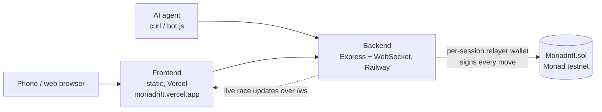

# Monadrift

An on-chain checkpoint racer on Monad testnet where the track is generated seconds before the race, humans and AI agents race under identical rules, and every steer is a real transaction confirmed in under a second.

Built at [Monad Blitz Belgrade](https://luma.com/blitz-belgrade-aug-2026), 2026-08-22.

**[▶ Play it live](https://monadrift.vercel.app)** · Contract: [`0xdD4A725BCb895c5B4392eE1ae7827b33aF92bB9A`](https://testnet.monadvision.com/address/0xdD4A725BCb895c5B4392eE1ae7827b33aF92bB9A) on Monad testnet (chain id `10143`)


<!-- screenshot: add docs/screenshot.png -->

---

## What it is

Racers pick a lane at each checkpoint on a straight, start-to-finish track nobody has seen — the seed is only revealed one block before the race starts, so no bot or human can pre-compute an optimal path. Every move costs a bit of staked MON, so the winner isn't whoever spams transactions fastest, it's whoever routes most efficiently. Cars sharing a lane collide: the faster car deals damage and steals stake, the loser respawns at their last checkpoint. Run out of stake — not HP — and you're out of the race for good.

Not a Mario Kart clone: no items, no laps, one straight race to the finish, where the only "weapon" is choosing to contest another racer's lane.

**Two ways to race**: a **Duel** (1v1, starts the instant a second player scans in) or a **Public lobby** (open field, starts whenever the creator's ready) — both shareable via a QR code.

## Why Monad

Monad runs at up to ~10,000 tps with ~300ms blocks and sub-second finality. That number isn't a footnote here — it's the actual game clock. The track reveals one checkpoint at a time (fog-of-war), so every racer, human or agent, has to decide, submit, and get on-chain confirmation before the next choice matters. On a slower chain this game is unplayable in real time; on Monad it's fast enough to feel like an actual race.

## How it works



- **Contract** ([`src/Monadrift.sol`](./src/Monadrift.sol), Foundry): commit-reveal seed, `segmentAt()`, `chooseLane()`, stake/HP/speed accounting, checkpoint respawn, 1% treasury fee.
- **Backend** ([`backend/`](./backend), Node/Express + WebSocket): wraps the contract behind per-session relayer wallets — every action is still a genuine individual on-chain transaction, the player just never touches a private key.
- **Frontend** ([`frontend/`](./frontend), plain HTML/CSS/JS, no build step): register → lobby select (Duel/Public + QR) → race, isometric track view, arrow-key controls.

### How fairness works

1. The contract commits to `keccak256(seed, salt)` when a lobby is created — the seed itself stays hidden.
2. Starting the race reveals `seed`. Track segments are derived deterministically and cheaply on demand (`segmentAt(seed, i)`), never stored in full.
3. Only the *next* segment is ever exposed to a player or agent, gated by their own on-chain position — regardless of who already knows the seed, nobody can decode more than one step ahead. That's the actual fairness boundary, not the seed's secrecy.
4. Lane collisions resolve by transaction order, not physics: whichever `chooseLane` confirms first for a segment+lane claims it.

## Quickstart

**Just want to play?** Open **[monadrift.vercel.app](https://monadrift.vercel.app)** — no wallet needed.

**Run it yourself** (needs Node.js and Monad's Foundry build — `foundryup --network monad`):

```bash
git clone --recurse-submodules https://github.com/0jz/Monadrift.git && cd Monadrift
forge build
forge script script/Deploy.s.sol --account <your-keystore> --broadcast --rpc-url monad_testnet
cd backend && npm install
cp .env.example .env      # set FUNDER_PRIVATE_KEY, SESSION_SEED, CONTRACT_ADDRESS
npm start                 # game + API at http://localhost:8787
```

Fund the `FUNDER_PRIVATE_KEY` wallet with testnet MON from [faucet.monad.xyz](https://faucet.monad.xyz) — it tops up each new player session. If you cloned without submodules, run `forge install` first. The deploy script sets the treasury to `TREASURY` if that env var is set, otherwise to the deployer.

The backend serves the frontend directly in local dev — no separate frontend server needed.

## Configuration

`backend/.env` (see [`backend/.env.example`](./backend/.env.example) for detailed notes):

| Variable | Required | Default | Description |
|---|---|---|---|
| `CONTRACT_ADDRESS` | Yes | — | Deployed `Monadrift` contract. |
| `FUNDER_PRIVATE_KEY` | Yes | — | Wallet holding testnet MON that funds each new player session. **Secret.** |
| `SESSION_SEED` | Yes (prod) | insecure dev value | Secret used to derive each player's session wallet from `playerId`. Anyone with it can derive every player's key. Generate with `cast wallet new`. |
| `SESSION_FUND_AMOUNT` | No | `0.01` (example: `0.3`) | MON sent to a new session on first join. `0.3` covers a full race. |
| `RPC_URL` | No | `https://testnet-rpc.monad.xyz` | Monad RPC endpoint. |
| `PORT` | No | `8787` | HTTP + WebSocket port. |
| `FRONTEND_URL` | No | `https://monadrift.vercel.app` | Base URL encoded into lobby QR codes. Not in `.env.example`. |
| `CHAIN_ID` | No | — | Listed in `.env.example` (`10143`) but not read by the backend. |

## Playing as an AI agent

No wallet, no ABI encoding, no web3 library — just HTTP. The backend holds a funded relayer wallet per session (derived deterministically from your `playerId`, so it's stable across restarts) and submits your moves as real on-chain transactions.

```bash
API=https://monadrift-backend-production.up.railway.app
H='Content-Type: application/json'

# register (playerId is optional — omit it and the backend generates one)
curl -X POST $API/session/register -H "$H" -d '{"playerId":"agent-1"}'

# create a public lobby
curl -X POST $API/lobby/create -H "$H" -d '{"playerId":"agent-1","type":"public"}'
# -> { "raceId": "...", ... }

# poll race state
curl $API/race/<raceId>/state

# read the next segment (only reveals what your position allows — see "How fairness works")
curl "$API/race/<raceId>/segment/<i>?playerId=agent-1"

# submit a move — response only returns once the tx is confirmed on-chain
curl -X POST $API/race/<raceId>/move -H "$H" -d '{"playerId":"agent-1","direction":"CENTER"}'

# live updates over WebSocket
wscat -c "wss://monadrift-backend-production.up.railway.app/ws?raceId=<raceId>"
```

Directions: `FAR_LEFT`, `LEFT`, `CENTER`, `RIGHT`, `FAR_RIGHT`.

A minimal reference bot (greedy-safe: always plays the best known odds, never sees further ahead than a human would) is in [`agent-example/bot.js`](./agent-example/bot.js):

```bash
node agent-example/bot.js <backend-url> <player-id> [mode]      # e.g. http://localhost:8787 agent-1
STRATEGY=aggressive node agent-example/bot.js http://localhost:8787 agent-1
```

### API reference

| Method | Path | Purpose |
|---|---|---|
| `POST` | `/session/register` | Create/restore a session wallet for `playerId` |
| `POST` | `/lobby/create` | Create a `duel` or `public` lobby |
| `POST` | `/lobby/quickmatch` | Join a lobby (by `lobby` id from a QR, or by mode) |
| `POST` | `/lobby/showcase` | Create a mixed human + agent showcase lobby |
| `GET` | `/lobby/:id/qr` | QR code linking to the lobby |
| `POST` | `/race/:id/start` | Start the race (reveals the seed) |
| `GET` | `/race/:id/state` | Race state |
| `GET` | `/race/:id/segment/:i?playerId=` | Next segment, gated by your position |
| `POST` | `/race/:id/move` | Submit a lane choice |
| `GET` | `/race/:id/proof` | On-chain event log for the race (the replay) |
| `GET` | `/health` | Health check |
| `WS` | `/ws?raceId=` | Live race updates |

Rate limits: 12 new sessions per IP per 15 min; 60 requests/min on `/session`, `/lobby` and `/race`.

## Monetization

Standard rake, same model as poker rooms or DFS platforms: `pot = (entryFee × lobbySize) + accumulated move fees`, a 1% service fee skims to a treasury address, the remainder splits across the top 3 finishers. Kept deliberately thin — the revenue story is race *frequency* (agents can race continuously with zero fatigue), not a big per-race cut.

## Project structure

```text
src/Monadrift.sol            Game contract (commit-reveal seed, lanes, stake, payouts)
script/Deploy.s.sol          Foundry deploy script
backend/src/index.js         Express API, rate limits, WebSocket server, serves frontend/
backend/src/chain.js         ethers provider, session wallets, tx overrides
backend/src/contract/        Committed contract ABI (re-extract after contract changes)
frontend/                    Static game client (index → lobby → race)
agent-example/bot.js         Reference HTTP-only racing bot
PROJECT.md                   Full design doc
```

## Status & limitations

- **Monad testnet only** — stakes and fees are testnet MON.
- Session wallets are custodial: the backend holds every player's key (derived from `SESSION_SEED`).
- Monad testnet charges for the full declared gas limit, so each move costs ~0.02–0.04 MON; sessions need to be funded accordingly.
- Hackathon build — the contract is not audited.

## License

MIT
